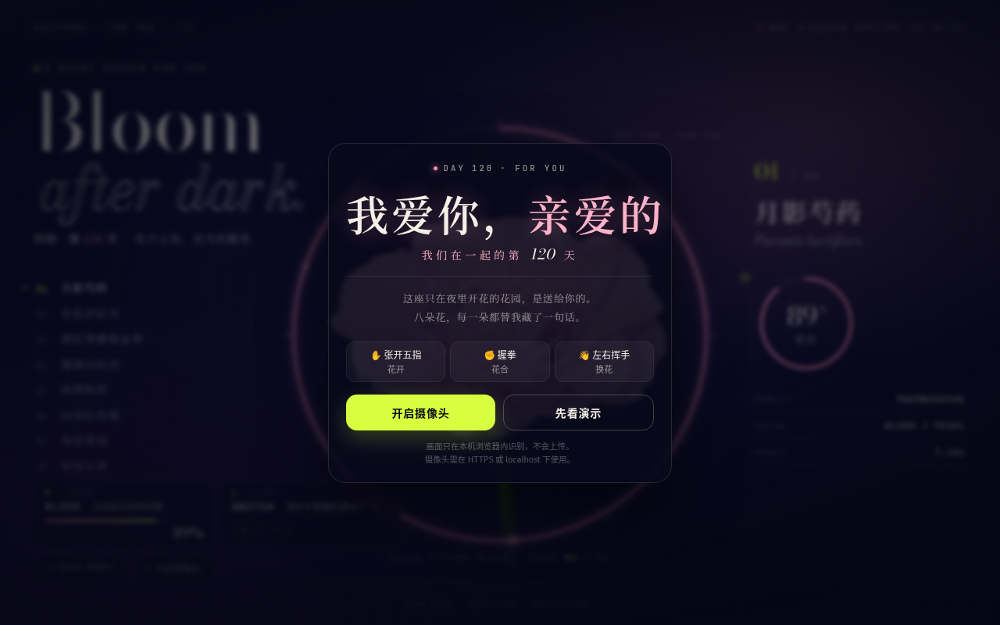
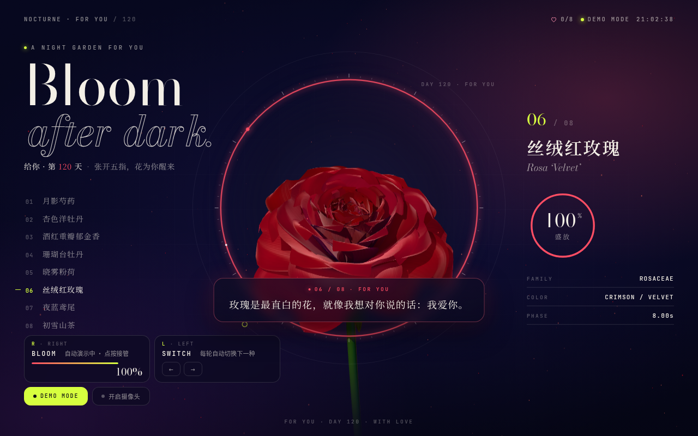
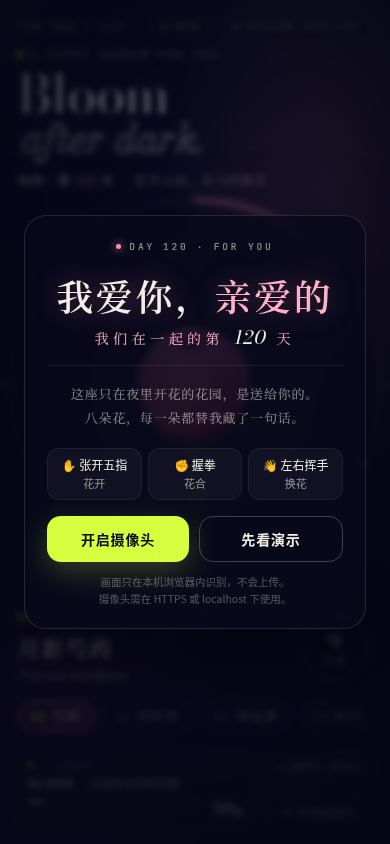

<div align="center">

# 🌹 手势控制绽放 · Bloom after dark

**张开手，花就开了。**


</div>

这是我送给女朋友的 **120 天纪念日礼物**：一座只在夜里开花的手势花园。打开摄像头，对着屏幕张开五指，3D 花朵就在夜色里慢慢绽放；握拳，它又合成花苞；挥一挥手，换下一种花。开场是「我爱你，亲爱的」，每朵花开到盛放时会浮现一句写给她的话，八朵花都看过之后，会打开一封信，花瓣从屏幕上飘落。

代码全部开源，你可以改几行文案，把它变成送给你自己的 TA 的礼物 💌

## ✨ 体验

可本地运行或自行部署体验（见下文「本地运行」和「部署」）。手机、电脑都能打开。允许使用摄像头后就能用手势控制；不想开摄像头也可以选「演示模式」或「触控模式」。

## 📸 截图

| 开场 | 盛放 |
| :---: | :---: |
|  |  |
| **终章：一封信** | **手机竖屏** |
|  |  |

## 🌸 特性

- **8 种花**：月影芍药、杏色洋牡丹、酒红重瓣郁金香、珊瑚台牡丹、晓雾粉荷、丝绒红玫瑰、夜蓝鸢尾、初雪山茶
- **全程序化 3D 建模**（three.js + 自定义着色器），没有一个外部模型文件：
  - 每片花瓣都是参数化曲面，有弯曲、内凹、波浪边、锯齿、褶皱，而且每片都略有不同
  - 外层花瓣先开，花蕊、雄蕊、莲蓬、鸢尾须毛随花期依次展开
  - 叶脉、渐变、边缘色、背面色、透光（次表面散射近似）、丝绒光泽、软阴影和环境反射
- **手势识别**：MediaPipe Hand Landmarker（双手、21 个关键点），根据关节角度计算手掌张开度，做了平滑与防抖；右下角实时显示手部骨架
- **4 段式花期**：含苞 → 初绽 → 半开 → 盛放（FRAME 01–04）
- **礼物模式**：开场告白、每朵花一句情话、集齐八朵后的信和飘落花瓣，全部集中在 `js/gift.js` 配置
- **移动端优先**：竖屏、横屏、桌面分别布局，适配刘海屏安全区
- **自适应画质**：帧率不够时依次降低分辨率、关闭阴影
- **隐私友好**：视频只在本机浏览器里识别，不上传任何画面
- **纯静态、零依赖安装**：无需构建、无需后端，所有依赖都在仓库里（国内网络也能直接用）

## 🖐️ 手势操作

| 动作 | 效果 |
| --- | --- |
| 张开五指 | 花朵绽放（张得越开，开得越盛） |
| 握拳 | 花朵闭合成花苞 |
| 张开手掌向左挥 / 向右挥 | 下一种花 / 上一种花 |
| 双手 | 屏幕右侧的手控制开合，左侧的手负责挥动切换（只用一只手也能完成全部操作） |

没有摄像头时：

- **演示模式**：自动开合、自动换花，转完一圈（约 1 分半）后自动打开信
- **触控模式**：上下滑动控制开合，左右滑动切换，点按开 / 合

右上角的 **♡ 0/8** 显示已经看过几朵花，点它（或按 `H`）随时打开信，`Esc` 关闭。

## 💌 如何改成送给你自己的 TA

只需要改一个文件：**`js/gift.js`**

```js
export const GIFT = {
  name: '亲爱的',          // 对 TA 的称呼
  nameEn: 'YOU',
  from: '爱你的人',        // 落款
  days: 120,               // 在一起的天数
  startDate: null,         // 例如 '2026-06-26'；填了会按今天自动算天数（第一天算第 1 天），days 就不用了
  title: '手势控制绽放 · {days} 天',   // 网页标题
  headline: '我爱你，{name}',
  subline: '我们在一起的第 {days} 天',
  lines: { peony: '…', ranunculus: '…', … },   // 8 种花各一句，盛放时浮现
  letter: { title, paragraphs: [...], sign },  // 最后的信
  autoFinale: true,        // 八朵花都盛放过后自动打开信
};
```

- 文案里可以写 `{name}`、`{days}`、`{from}`，会自动替换
- 改完后部署到任意 HTTPS 静态托管（见下文），把链接发给 TA 就好
- 调试文案时可以用 `?finale=1` 直接打开信，`?line=1` 让当前花的那句话一直显示，例如 `?mode=demo&still=1&sp=rose&line=1`

## 🚀 本地运行

```bash
git clone https://github.com/tan396222-prog/gesture-bloom.git
cd gesture-bloom

# 任选一种静态服务器，然后在电脑上打开 http://localhost:8080
python3 -m http.server 8080
# 或
npx serve -l 8080 .
```

> 用手机访问电脑的局域网 IP（`http://192.168.x.x`）时不是 HTTPS，摄像头会被禁用（页面会提示并自动切换到触控模式）。想在手机上调试，可以部署到 HTTPS 托管，或者用 `cloudflared tunnel` / `ngrok` 之类的 HTTPS 隧道。

## ☁️ 部署（必须用 HTTPS）

浏览器只允许在 **HTTPS**（或 `localhost`）页面里调用摄像头。把整个仓库原样上传到任意静态托管即可，入口是 `index.html`。

- **Cloudflare Pages / Vercel / Netlify**：直接上传或关联本仓库。Framework 选 “None / Other”，Build Command 留空，Output Directory 填 `.`（根目录）。作者自己就是用 Cloudflare Pages 部署的
- **GitHub Pages**：Fork 本仓库后，在 Settings → Pages 里选择 `main` 分支、根目录即可
- **国内**：腾讯云 COS / 阿里云 OSS 开启静态网站托管，绑定域名并配置 HTTPS 证书（CDN 加速可选）
- **Nginx**：

```nginx
server {
  listen 443 ssl http2;
  server_name bloom.example.com;
  root /var/www/bloom;
  index index.html;
  types { application/wasm wasm; application/javascript js mjs; }
  location ~* \.(wasm|task|js|css)$ { expires 30d; add_header Cache-Control "public"; }
}
```

注意：

1. `.wasm` 文件要以 `application/wasm` 返回（主流托管默认如此），`.js` 文件要以 JavaScript 类型返回
2. 第一次开启摄像头时会下载约 17 MB 的模型和 WASM 文件（之后走浏览器缓存），加载进度显示在右上角的状态灯上
3. 本地文件加载失败时，会自动改用 jsDelivr、npmmirror（国内镜像）、unpkg 或 Google Storage

## 🔧 URL 参数（可选）

| 参数 | 作用 | 示例 |
| --- | --- | --- |
| `sp` | 初始花种（id 或序号） | `?sp=lotus`、`?sp=3` |
| `mode` | 跳过启动页，直接进入演示 / 触控模式 | `?mode=demo` |
| `still` | 固定花期 0–1（截图、做海报用） | `?still=0.85` |
| `q` | 画质档位 `low` / `high`（默认：手机 low，电脑 high） | `?q=high` |
| `finale` | 直接打开信 | `?finale=1` |
| `line` | 一直显示当前花的那句话 | `?line=1` |

花种 id：`peony` `ranunculus` `tulip` `treepeony` `lotus` `rose` `iris` `camellia`

## ⌨️ 键盘（桌面）

| 按键 | 作用 |
| --- | --- |
| `←` `→` | 切换花种 |
| `↑` `↓` / 滚轮 | 调整开合 |
| `空格` | 开 / 合 |
| `1`–`8` | 直接选花 |
| `D` | 演示模式 |
| `C` | 开关摄像头 |
| `H` / `Esc` | 打开 / 关闭信 |

## 🌱 自定义 / 添加花种

在 `js/flora/species.js` 的 `SPECIES` 数组里添加一项：

```js
{
  id: 'myflower', zh: '我的花', short: '我的花', latin: 'Flora nova', family: 'FAMILY', color: 'PINK / WHITE',
  accent: '#ff8fb1',          // 界面强调色
  pollen: '#ffd9c8',          // 漂浮光点颜色
  seed: 42,                   // 随机种子（决定每片花瓣的细微差异）
  build: peony,               // 构建函数：可以复用现有的，也可以仿照写新的
  view: { elev: 0.7, targetY: [0.34, 0.26], radius: 1.2 },   // 相机俯角、注视高度（花苞→盛放）、取景半径
  lights: { exposure: 0.95 }, // 可选：主光 / 轮廓光 / 补光 / 曝光
}
```

构建函数返回 `petalSets`（多组花瓣）、`stamens`（雄蕊）、`extras`（花心附件）和 `stem`（花茎）。每片花瓣的主要参数：

| 参数 | 含义 |
| --- | --- |
| `phi` | 瓣基与竖直方向的夹角 `[花苞, 盛放]` |
| `k1` / `k2` | 沿瓣长的弯曲 |
| `cup` | 横向内凹 |
| `wrap` | 花苞时贴合球面的程度 |
| `delay` / `span` | 开放的时间顺序 |
| `base` / `mid` / `tip` / `edge` | 颜色渐变 |
| `ruffle` / `crinkle` / `jag` | 边缘波浪、褶皱和锯齿 |

## 📁 目录结构

```
index.html                   页面结构
css/style.css                样式（移动端优先 + 桌面 / 横屏）
js/gift.js                   ★ 礼物配置：名字、天数、八句话、信
js/main.js                   入口：模式切换、输入、主循环、自适应画质、盛放情话
js/ui/finale.js              终章：信 + 飘落花瓣
js/ui/hud.js                 HUD：花种列表、信息面板、刻度环、提示
js/vision/hands.js           摄像头 + MediaPipe 手势识别（张开度、横扫检测、骨架绘制）
js/flora/engine.js           3D 引擎：花瓣曲面、雄蕊、花茎、灯光、相机构图、粒子
js/flora/shaders.js          花瓣着色器（顶点变形 + 片元着色 + 光照模型）
js/flora/species.js          8 种花的参数定义
js/lib/three.js              three.js 多源加载器
vendor/three/                three.js 0.170.0（本地副本）
vendor/mediapipe/            @mediapipe/tasks-vision 0.10.21（JS + WASM 本地副本）
models/hand_landmarker.task  手部关键点模型（float16）
docs/                        README 截图
```

## 📱 兼容性

- iOS 15+ Safari、Android Chrome / Edge / 华为 / 小米 / 三星浏览器的较新版本；也支持微信内置浏览器（iOS 14.3+）
- 需要 WebGL 2（近 5 年的手机几乎都支持）
- 手势识别优先用 GPU，不支持时自动改用 CPU

## 📜 第三方许可

本仓库内附带了以下第三方组件，它们各自保留原有许可：

- [three.js](https://github.com/mrdoob/three.js)（`vendor/three/`）— MIT License
- [MediaPipe Tasks Vision](https://github.com/google-ai-edge/mediapipe) 与 Hand Landmarker 模型（`vendor/mediapipe/`、`models/`）— Apache License 2.0

版式灵感参考 “NOCTURNE · BOTANICAL KINETICS / 26”。

## License

本项目代码以 [MIT License](LICENSE) 开源。© 2026 tan396222-prog

<div align="center">

*第 120 天，只是开始。* 🌹

</div>
